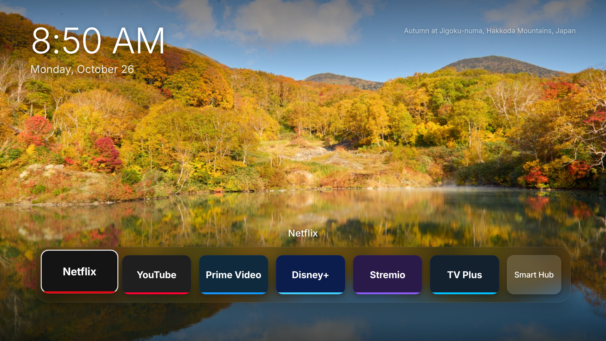

# Samsung TV: debloat + Quiet Home

Make a slow, ad-filled Samsung (Tizen) TV quiet again, with a way back:

1. **Find** the TV on your Wi-Fi and connect as a remote.
2. **Back up** every setting this touches, with a photo of each, before anything changes.
3. **Debloat**: turn off content recognition, ad targeting, voice uploads, promo
   pop-ups, autoplaying trailers and the TV Plus autostart, tidy the Home row, and
   block ad/tracker servers with DNS. You're asked before each change, and
   nothing is uninstalled.
4. **Quiet Home**: a fast, minimal Apple TV-style home screen with a dock of
   your apps over rotating nature photos, set to start at power-on.
5. **Restore**: `./restore.sh` puts every setting back to its backed-up value
   and can remove Quiet Home.



Kept on purpose: screen mirroring/casting (SmartThings, AirPlay) and the Samsung
TV Plus app. Voice assistant data upload is turned off (you said you don't use it).

## Run it

From a computer on the **same Wi-Fi as the TV** (macOS or Linux; Windows via
WSL), with the TV switched on:

```sh
python3 tv.py find        # finds the TV and remembers it
python3 tv.py pair        # choose Allow on the TV
python3 tv.py backup      # records everything as it is now; changes nothing
python3 tv.py debloat     # one change at a time, each explained, each asks first
python3 tv.py install     # Quiet Home: needs the one-time setup in docs/INSTALL.md
python3 tv.py autostart   # pin it and make the TV start in it
python3 tv.py status      # what's changed
./restore.sh              # undo all of it
```

Everything is saved as it goes in `backups/<date>/`: `session.json` (each
setting's before/after value), `device.json`, `apps.txt`, `duid.txt`, `log.jsonl`
(every key press and step) and `photos/`. Press Ctrl-C at any point and rerun
to continue. Copy the backup folder somewhere safe.

**If the TV loses internet after the DNS step** but your other devices don't:
`./restore.sh --only dns`, or on the TV **Settings > All Settings > Connection >
Network > Network Status > IP Settings > DNS Setting > Get automatically**.

## Why the TV settings are done by hand

On Android TV you can disable packages over ADB. A Samsung TV runs Tizen, not
Android: there is no ADB. Samsung's `sdb` on a retail TV can install your own
apps and read a few things, but it can't disable Samsung's apps or change
settings. Blind key sequences would be unsafe too: the menus differ by model and
year, and **Factory Data Reset** sits one item below Start Screen Options. So
`tv.py` explains each change and where it is, can press the first keys for you,
waits while you make the change with the remote, then records the result.

Not included because they can't be undone: Reset PSID (advertising ID),
declining Smart Hub terms (that disables every app), Reset Smart Hub.

## Photos of the TV

Samsung TVs can't send screenshots over the network, so every step is checked
with a photo of the screen instead. Any one of these works:

- **A camera on this computer**, pointed at the TV (e.g. an iPhone as a
  Continuity Camera on a Mac). Set `TV_CAMERA`, and `ffmpeg` takes each photo:
  `TV_CAMERA=avfoundation:0` (Mac), `TV_CAMERA=v4l2:/dev/video0` (Linux).
  List Mac cameras with `ffmpeg -f avfoundation -list_devices true -i ""`.
- **Your phone as a live camera**: `python3 tools/phonecam.py serve`, open the
  printed address on the phone, aim it at the TV. Stop it (Ctrl-C) afterwards.
- **Neither**: you're asked to take each photo yourself and can drag the file in.

## Quiet Home

- A dock of Netflix, YouTube, Prime Video, Disney+, Stremio and Samsung TV Plus,
  plus **Smart Hub** last: Samsung's own home screen, your way back to settings
  and inputs. Apps that aren't installed are left out.
- Twelve CC0 nature photos crossfade every minute with a slow drift. A clock
  and date are shown, with the photo's title.
- Left/Right and OK on the remote. No network access, no tracking, no
  framework. Timers stop while another app is open.
- Settings in [`launcher/js/config.js`](launcher/js/config.js): dock apps and
  order, photo interval, drift (turn it off on an older TV), date format.

It can't replace what the remote's Home button opens: Samsung doesn't allow
that. With **Autorun Last App** on, the TV starts in Quiet Home if you turned it
off from Quiet Home, and Samsung's Home has it as the first tile.

Preview it in a browser: `node dev/preview.mjs`, open <http://localhost:8080>,
use the arrow keys. `node dev/screenshot.mjs` (needs Playwright) refreshes
`docs/screenshots/`.

## Credits

Built on [Glass Home](https://github.com/victaphu/glass-home-samsung-tv) and
[Arn0 Launcher](https://github.com/NelsonEU/arn0-tv) (both MIT). See
[CREDITS.md](CREDITS.md).
