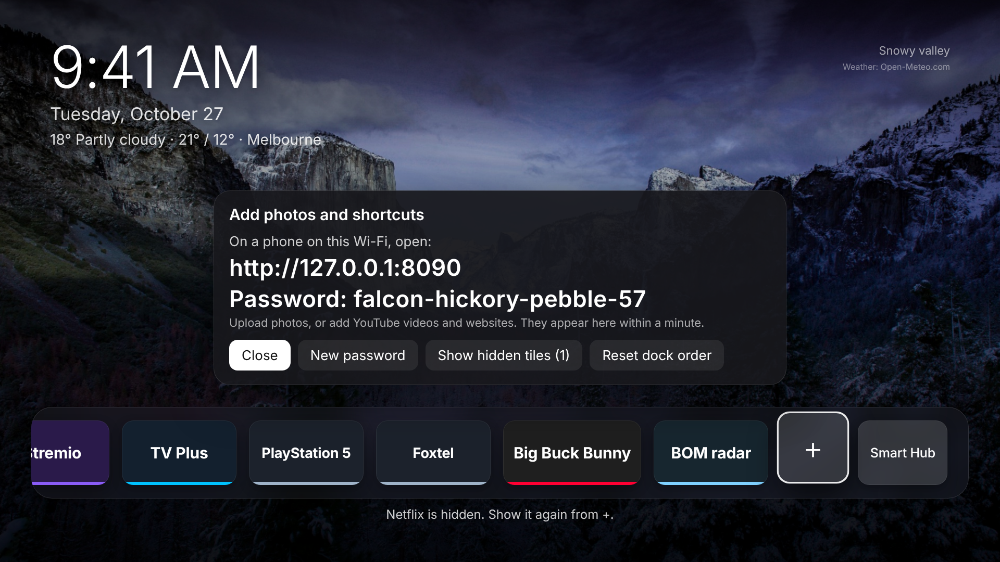

# Samsung TV: debloat + Quiet Home

Make a slow, ad-filled Samsung (Tizen) TV quiet again, with a way back:

1. **Find** the TV on your Wi-Fi and connect as a remote.
2. **Back up** every setting this touches before anything changes.
3. **Debloat**: turn off content recognition, ad targeting, voice uploads, promo
   pop-ups, autoplaying trailers and the TV Plus autostart, tidy the Home row, and
   block ad/tracker servers with DNS. You're asked before each change, and
   nothing is uninstalled.
4. **Quiet Home**: a fast, minimal Apple TV-style home screen with a dock of
   your apps over rotating nature photos, set to start at power-on.
5. **Restore**: `python tv.py restore` puts every setting back to its backed-up value
   and can remove Quiet Home.


Kept on purpose: screen mirroring/casting (SmartThings, AirPlay) and the Samsung
TV Plus app. Voice assistant data upload is turned off (you said you don't use it).

## Run it

From a computer on the **same Wi-Fi as the TV** (Windows, macOS or Linux, with
[Python 3](https://www.python.org/downloads/) and Git), with the TV switched on.
In PowerShell (Windows) or Terminal (macOS/Linux):

```sh
git clone https://github.com/CannedSpoon/Samsung-tv
cd Samsung-tv
git checkout claude/android-tv-debloat-homescreen-1o5gjy

python tv.py find        # finds the TV and remembers it
python tv.py pair        # choose Allow on the TV
python tv.py backup      # records everything as it is now; changes nothing
python tv.py debloat     # one change at a time, each explained, each asks first
python tv.py status      # what's changed
python tv.py restore     # undo all of it (or restore.bat / ./restore.sh)
```

On macOS/Linux type `python3` instead of `python`.

Then Quiet Home, after the one-time setup in [docs/INSTALL.md](docs/INSTALL.md)
(Samsung's free tools and certificate; `python tv.py doctor` says what's missing):

```sh
python tv.py install     # build, install, check it's on screen
python tv.py autostart   # pin it and make the TV start in it
```

Everything is saved as it goes in `backups/<date>/`: `session.json` (each
setting's before/after value), `device.json`, `apps.txt`, `duid.txt`, `log.jsonl`
(every key press and step) and, if a webcam is set up, `photos/`. Press Ctrl-C at any point and rerun
to continue. Copy the backup folder somewhere safe.

**If the TV loses internet after the DNS step** but your other devices don't:
`python tv.py restore --only dns`, or on the TV **Settings > All Settings > Connection >
Network > Network Status > IP Settings > DNS Setting > Get automatically**.

## Why the TV settings are done by hand

On Android TV you can disable packages over ADB. A Samsung TV runs Tizen, not
Android: there is no ADB. Samsung's `sdb` on a retail TV can install your own
apps and read a few things, but it can't disable Samsung's apps or change
settings. Blind key sequences would be unsafe too: the menus differ by model and
year, and **Factory Data Reset** sits one item below Start Screen Options. So
`tv.py` explains each change and where it is, can press the first keys for you,
waits while you make the change with the remote, then records the result.

Not included because they can't be undone: Reset PSID (advertising ID),
declining Smart Hub terms (that disables every app), Reset Smart Hub.

## Checking each step (no photos needed)

Each change ends with you confirming what the TV now shows, and `tv.py` checks
the TV's own reports where it gives them: Quiet Home installed, on screen, and
starting at power-on. Samsung TVs can't send screenshots over the network, so
photos are an optional extra record:

- **A webcam pointed at the TV** (the easiest): install
  [ffmpeg](https://ffmpeg.org/) (Windows: `winget install Gyan.FFmpeg`, then a
  new PowerShell window; macOS: `brew install ffmpeg`; Linux: `sudo apt install
  ffmpeg`), point the webcam at the TV, and run once:
  ```sh
  python tv.py camera        # finds the webcam, takes a test photo, remembers it
  ```
  Open `state/camera-test.jpg` to check the TV is in view. From then on every
  step is photographed into the backup folder by itself. `python tv.py camera
  --off` stops it. Close Teams/Zoom/Camera first: only one app can use a webcam.
- **Your phone as a live camera**: `python tools/phonecam.py serve`, open the
  printed address on the phone, aim it at the TV. Needs `openssl` (built into
  macOS/Linux; on Windows it comes with Git, in `C:\Program Files\Git\usr\bin`,
  which must be on PATH).
- **Phone photos by hand**: set `TV_PHOTOS=ask` and you're asked at each step.

## Quiet Home



**The dock**, in this order until you move things:
- **Your apps:** YouTube, Prime Video, Stremio and Samsung TV Plus. Apps that
  aren't installed are left out; if an app has more than one ID on Samsung TVs,
  each is tried until one opens.
- **Website tiles** from `sites` in `launcher/js/config.js` (FrameX TV for now),
  opened in Samsung's own browser.
- **HDMI inputs** with something plugged in. Name them with
  `python tv.py hdmi 1 "PlayStation 5"`; otherwise they show as "HDMI 1".
- **Shortcuts you add from your phone:** YouTube videos and websites.
  (Add a website here too, without touching config.js.)
- **+**, then **Smart Hub** (Samsung's own home screen, your way back to
  settings), which always stay last.

**The tiles look like the apps:** each shows the app's mark on a background like
its own icon (YouTube, Prime Video, Stremio, PlayStation, Xbox, Switch, Foxtel,
Samsung and more, in `launcher/js/brands.js`). HDMI tiles named after a device
get its mark, and YouTube shortcuts show the video's thumbnail. The focused tile
lifts, glows in the app's colour and catches a sweep of light. An app with no
mark shows the icon the TV reports for it, or its name.

**The screen:**
- **Photos:** 20 nature photos (12 CC0 from Glass Home, 8 Unsplash from Arn0)
  plus any you upload, crossfading every minute with a slow drift.
- **Clock and date,** and optionally the weather:
  `python tv.py weather "Melbourne"` (Open-Meteo, free, no account).
- **Screensaver:** after 3 minutes idle, only the photos and the clock show.
  The first button press just wakes it.
- **Evening dimming:** photos are darker from 21:00 to 06:00.

| Remote | What happens |
|---|---|
| Left / Right | move along the dock |
| OK | open the app, input, video or website |
| Hold OK | Move left, Move right, Hide (or Remove, for a shortcut), Cancel |
| 1 to 9 | open that tile straight away |
| OK on **+** | the photo website's address and password; New password; show hidden tiles; reset the order |
| Back | closes a menu; does nothing on the home screen |

**The photo website** (from Glass Home): open the address shown under **+** on
a phone on your Wi-Fi and sign in with the password shown there. Upload photos
(resized on the phone, so iPhone HEIC works) or add YouTube and website
shortcuts; they appear on the TV within about 20 seconds. It's plain HTTP and
only answers devices on your home network. It was tested on a 2023 TV (Tizen 8);
if your TV can't run it, the + panel says so and everything else still works.

**Settings:** everything is in [`launcher/js/config.js`](launcher/js/config.js)
(dock apps, photo interval, drift, screensaver, dimming hours, HDMI behaviour,
number keys, photo website on/off). `tv.py weather` and `tv.py hdmi` write
your own values to `launcher/js/config.local.js`. After any change, run
`python tv.py install` (with Developer Mode on).

**Network use:** only the photo website on the TV itself and, if you turn it on,
the weather. No tracking.

It can't replace what the remote's Home button opens: Samsung doesn't allow
that. With **Autorun Last App** on, the TV starts in Quiet Home if you turned it
off from Quiet Home, and Samsung's Home has it as the first tile.

**Preview it in a browser:** run `node dev/preview.mjs`, open
<http://localhost:8080> and use the arrow keys. `node dev/run-website.js` also
runs the photo website locally (after `python tv.py install` has made
`launcher/js/local-key.js`). To add bundled photos, see `dev/wallpapers.py`.

## Credits

Built on [Glass Home](https://github.com/victaphu/glass-home-samsung-tv) and
[Arn0 Launcher](https://github.com/NelsonEU/arn0-tv) (both MIT). See
[CREDITS.md](CREDITS.md).
